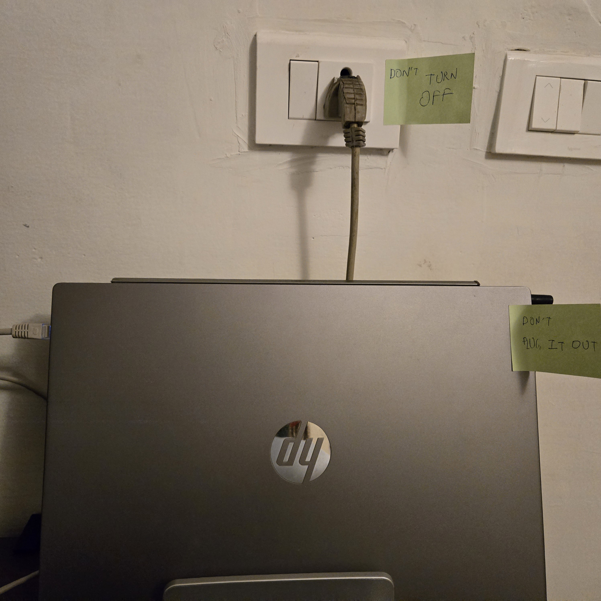
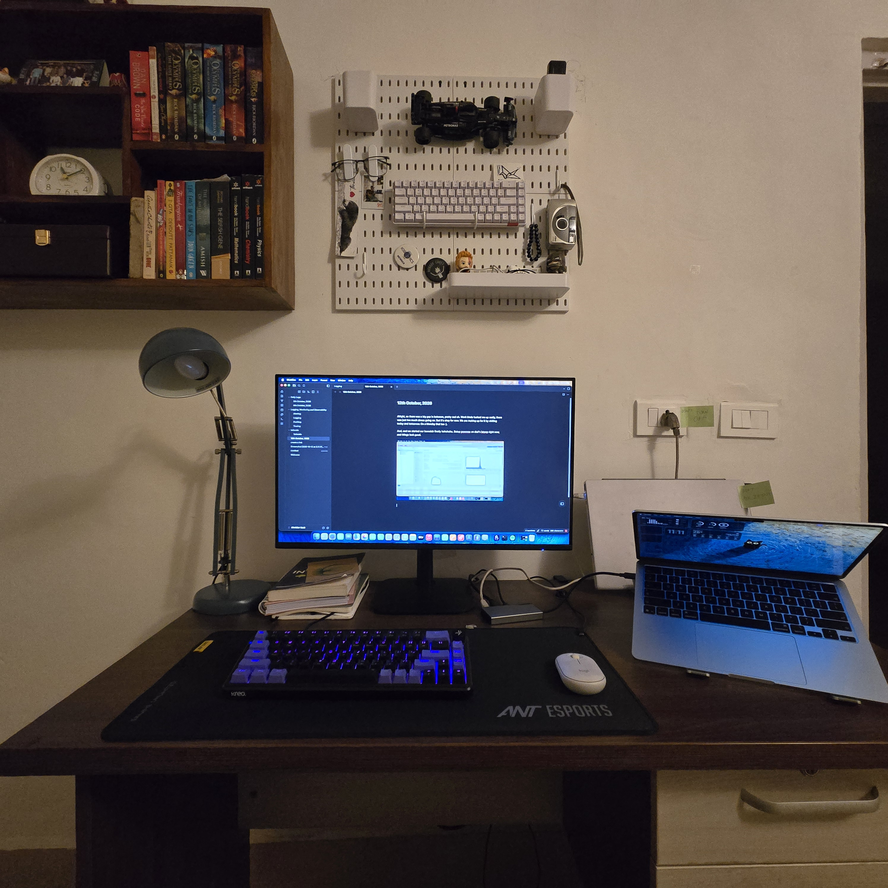

# Mancave Lab

Beginning of my mancave homelab, hopefully this goes far :)

Some photos to begin with:

October 12th, 2026:

  
  <!-- Left Column Container -->
  

    
  

  
  <!-- Right Column Container -->
  

    

      
    

    

      
    

  

