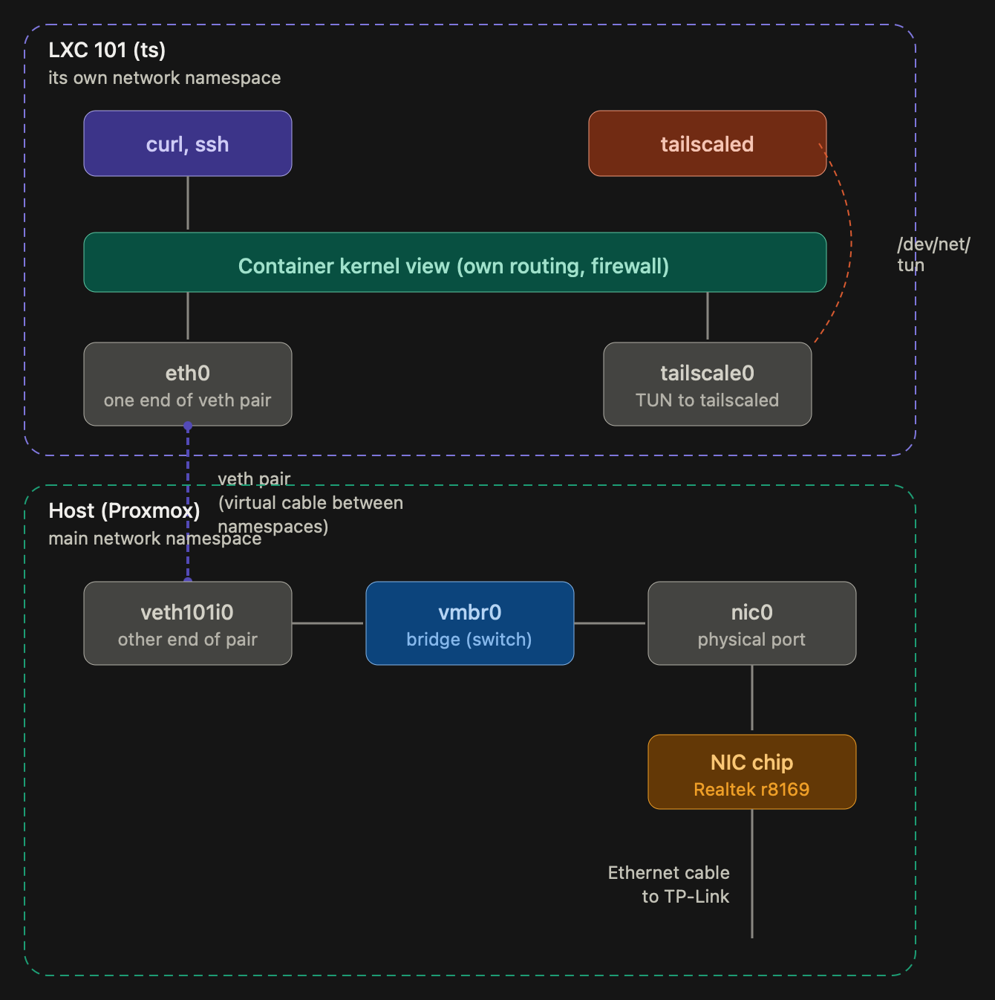

# mancave.lab: Project Context

Oct 19, 2026 · @Vikrant

## Overview

mancave.lab is a homelab project: turn an old HP laptop into a low-power playground for learning infrastructure engineering, connected to a VPS and phone over Tailscale. The owner already knows Go and wants hands-on practice with virtualization, IaC, monitoring and networking.

**Goals**

- Run the HP laptop as a Type 1 hypervisor (Proxmox preferred) and manage it with code (Terraform/OpenTofu, Ansible, cloud-init, Git)
- Self-host small services (Pi-hole, Uptime Kuma, Jellyfin and similar)
- Extend the existing VPS monitoring stack (Prometheus, Grafana) to cover the lab
- Build Go tools for the lab (exporters, a lab CLI, tsnet services)
- Possibly provision disposable dev VMs for outside users

**How to use this doc in a new chat:** share it as context at the start, treat sections marked unconfirmed as open, and append new decisions to the Changelog at the end. Runbooks are separate files (`runbook_01_*`, `runbook_02_*`, …) kept with this doc; share the relevant one when picking up an operational task.

## Hardware inventory

Four pieces of hardware are in play, and RAM and storage on the laptop cannot be expanded for now.

| Device | Role | Specs | Notes |
| --- | --- | --- | --- |
| HP Pavilion 15-cs1052tx (5JR96PA) | Lab host, Proxmox VE 9.2 (kernel 7.0.14-23-pve) | Core i7-8565U (4 cores, 8 threads), 8 GB DDR4, 2 TB HDD, NVIDIA GeForce GPU | On lab subnet 192.168.50.x via TP-Link, reserved at .10 (MAC `c8:d9:d2:93:53:93`). Joined to the tailnet directly as of 2026-10-14 (plain `tailscale up`, no SSH, no exit node, no advertised routes yet). Ethernet confirmed (Realtek r8169). GPU model still unconfirmed (likely MX150). Internal laptop battery dead — runs on AC only. CMOS coin cell (CR2032) dead — BIOS settings and clock reset on full power loss. AC backed by a home inverter which stands in as UPS. |
| Philips WiZ bulb (ESP25_SHRGB_01, firmware 1.38 Pro) | IoT light driven by the `wizmood` LXC | RGBCW E27, Wi-Fi only | On the **home** subnet 192.168.31.0/24 (not the lab subnet), DHCP from AirFiber. Local UDP control on port 38899 requires WiZ app → Settings → Security → Allow Local → "Allow all controls" (newer firmwares default to "Only verified controls" which rejects unsigned writes with a misleading `-32602 Invalid params`). Cross-subnet reachable from the lab via unicast through TP-Link NAT; broadcast discovery does not cross. |
| TP-Link TL-WR841N v14 | Lab router behind the AirFiber | MT7628NN, 32 MB RAM, 4 MB flash, 2.4 GHz Wi-Fi only, five 10/100 ports | In router mode: WAN DHCP from AirFiber (192.168.31.x), LAN 192.168.50.0/24 with DHCP enabled. 2.4 GHz Wi-Fi available as backup admin access (separate SSID). No USB port. OpenWrt not practical on 4/32 hardware, so use stock firmware. |
| Jio AirFiber box | Home internet gateway | 5G wireless, Wi-Fi 6, multiple LAN ports. Home LAN is on 192.168.31.0/24 (gateway likely 192.168.31.1). | LAN port count, speed and USB unconfirmed. Firmware is ISP-locked. Likely behind CGNAT. Bridge mode reportedly locked down — double NAT via TP-Link is the working approach. |
| VPS | Public host, monitoring | Provider and specs not recorded | Runs the owner's own service plus Prometheus and Grafana (being set up). |
| MacBook (owner's) | Admin workstation | Mac on AirFiber Wi-Fi for internet; wires into TP-Link via USB 10/100 Ethernet dongle (en5) when 192.168.50.x admin access is needed | Previously used for Internet Sharing to bootstrap the HP (runbook 01). Retired from that role on 2026-10-14 after TP-Link cutover (runbook 04). |

The owner also has a phone on the tailnet.

## Network and connectivity

The home connection is a Jio AirFiber box that probably sits behind carrier-grade NAT (CGNAT), so inbound port forwarding from the internet should not be relied on; Tailscale and the VPS provide remote access instead.

**Current layout (as of 2026-10-14)**

1. Jio AirFiber serves the home LAN on 192.168.31.0/24.
2. A LAN port on the AirFiber connects to the WAN port of the TP-Link WR841N; TP-Link gets a DHCP lease in the 192.168.31.x range on its WAN side.
3. TP-Link serves the lab subnet 192.168.50.0/24 on its LAN ports, DHCP enabled, default pool .100–.199.
4. HP (Proxmox) connects wired to a TP-Link LAN port, DHCP reserved at 192.168.50.10 (MAC `c8:d9:d2:93:53:93`). Pi-hole LXC reserved at 192.168.50.5.
5. Mac usually on AirFiber Wi-Fi (192.168.31.x); wires into the TP-Link when 192.168.50.x admin access is needed. TP-Link's own 2.4 GHz Wi-Fi can be enabled with a separate SSID (e.g. `mancave-lab`) as backup admin access.
6. Double NAT: no inbound from the internet, as expected under CGNAT. Tailscale handles remote access.
7. Retired: MacBook Internet Sharing (en0 → en5, bridge100 192.168.2.1/24). HP is no longer dependent on the Mac for connectivity.

**Notes**

- Never enable DHCP on two devices in the same subnet.
- If the AirFiber blocks custom DNS or DHCP, set DNS (for example Pi-hole) on the TP-Link's DHCP instead.
- Reserve a fixed lab address for the Proxmox host.
- Put the AirFiber and TP-Link on the same UPS as the laptop, otherwise a power cut kills connectivity.
- Bridge mode on Jio gear is reported as unreliable or locked down; double NAT is the working approach.

## Current state

Proxmox is installed, the lab subnet is live behind the TP-Link, the first LXC (Tailscale) is on the tailnet, and the host itself is now also a tailnet peer. Next up is monitoring and the next batch of LXCs.

- [x] Tailscale tailnet connecting the VPS, the owner's laptop and phone (that laptop is a different device from the HP Pavilion)
- [x] A service of the owner's is hosted on the VPS
- [x] Docker networking between the VPS services was learned in an earlier Claude Code session (stored locally, not searchable from claude.ai chats)
- [x] Proxmox installed on the HP laptop (PVE 9.2-1, kernel 7.0.14-23-pve, ext4, hostname pve.mancave.lab)
- [x] Switched Proxmox repos to no-subscription, ran dist-upgrade, verified KVM + bridge + services
- [x] First LXC: Tailscale (`ts`, container 101, on tailnet via DHCP on lab subnet) — Pi-hole, Uptime Kuma still to come
- [x] HP wired directly to the TP-Link, Mac no longer in the path
- [x] Lab router (TP-Link) placed behind the AirFiber
- [x] Tailscale on the Proxmox host itself (plain `tailscale up`; no SSH, no exit node, no advertised routes — can enable later)
- [x] Second LXC: `wizmood` (container 102, DHCP on lab subnet) — Spotify-reactive WiZ bulb service, egress-firewalled via nftables; see runbook_05
- [x] Third LXC: `pihole` (container 103, reserved at 192.168.50.5) — serves DNS for the lab subnet via TP-Link DHCP; local records for `pve.mancave.lab`/`pihole.mancave.lab`/`ts.mancave.lab`/`wizmood.mancave.lab`, upstream Cloudflare, StevenBlack unified blocklist; see runbook_06. HP reservation at .10 also finalized in the same session.
- [ ] Prometheus and Grafana on the VPS, monitoring the VPS and the hosted service with alerts (in progress)
- [ ] Node_exporter + cAdvisor on the lab, scraped by VPS Prometheus
- [ ] Subnet router for 192.168.50.0/24 on the tailnet (either the `ts` LXC or the host — decide when Pi-hole/Uptime Kuma land)
- [ ] UPS or other power-cut plan (inverter is current stopgap)
- [ ] Replace HP's CMOS coin cell (CR2032)

## Planned architecture

The plan is Proxmox VE on the HP laptop with one or two VMs plus several lightweight LXC containers, all created from code. Proxmox is KVM on Debian, so it counts as Type 1: installing it replaces the laptop's current OS.

**Rough RAM budget (8 GB total)**

| Component | RAM |
| --- | --- |
| Proxmox host | 1 to 1.5 GB |
| VM 1: Docker host (Uptime Kuma, Pi-hole, exporters) | 2 to 3 GB |
| VM 2: disposable practice VM | about 2 GB |
| Headroom | about 1 GB |

**Design choices**

- Prefer LXC (unprivileged) over full VMs where possible; an idle Debian LXC uses roughly 100 to 300 MB
- Use ext4 or LVM-thin; avoid ZFS because its cache consumes RAM
- Keep VM disks small (8 to 15 GB, thin-provisioned) because the 5400 RPM HDD is the bottleneck
- Enable ballooning and a small swap or zram as a safety net
- Use the wired Ethernet port for the bridge (`vmbr0`); put Tailscale in an LXC or VM, or run the host as a subnet router
- Enable VT-x (and VT-d if listed) in the BIOS, set "power on after AC loss" and make the lid-close action "do nothing"
- Set VMs and containers to start on boot with a defined order (DNS first)
- Default LXCs/VMs to DHCP; use TP-Link address reservations for stability rather than hardcoding static IPs in guest configs

**IaC workflow**

1. Build a cloud-init template (Debian or Ubuntu cloud image), by hand first and with Packer later
2. Clone it with OpenTofu or Terraform using the `bpg/proxmox` provider
3. Configure guests with Ansible (Docker, node\_exporter, hardening)
4. Keep everything in Git and practise a full destroy-and-rebuild
5. Back up VMs to the 2 TB HDD with Proxmox backups, and back up configs to the VPS over Tailscale

## Services roadmap

Start with small LXC services, wire them into monitoring, then automate, then go deeper on networking.

1. Install Proxmox on a wired connection; enable VT-x in the BIOS ✓
2. LXCs for Tailscale ✓, Pi-hole and Uptime Kuma
3. Add node\_exporter and cAdvisor on the lab and point the VPS Prometheus at them
4. Rebuild the same services with a cloud-init template, OpenTofu and Ansible
5. Networking practice: VLANs on the Proxmox bridge, then a firewall or router LXC or VM if RAM allows

**Candidate services and projects**

- Monitoring: a second Prometheus or Uptime Kuma on the lab that watches the VPS (so the VPS can be monitored if it dies), Loki for logs, blackbox exporter for probing, smartctl\_exporter for HDD health, and ping probes to graph the AirFiber's latency and uptime
- Network: Pi-hole as tailnet DNS (reachable from the phone), Tailscale subnet router, exit node and ACLs
- Backups: restic or borg from the VPS to the laptop over Tailscale, with tested restores
- Light apps: Vaultwarden, Jellyfin (Intel QuickSync transcoding), Forgejo or Gitea, Home Assistant, Caddy or Traefik as reverse proxy
- Too heavy for 8 GB: k3s across several VMs, Immich, Nextcloud, local LLMs, Windows VMs, OPNsense as a VM if other VMs are running

## Go project ideas

The suggested first Go project is a Prometheus exporter for something in the lab, because it is small, fits the existing monitoring stack and touches Go, Grafana, the tailnet and Git.

- **Monitoring:** custom Prometheus exporter (`client_golang`) for Proxmox VM status, Pi-hole per-device stats or the VPS service; an endpoint health checker; an Alertmanager webhook forwarder (Telegram, ntfy or Discord)
- **Tooling:** a `lab` CLI with `cobra` wrapping the Proxmox API, Terraform and Ansible; a backup orchestrator that runs and verifies restic; a small Git-pull deploy agent
- **Tailnet:** `tsnet` services that join the tailnet as their own node (internal dashboard, status page, pastebin)
- **Stretch:** a Kubernetes controller (later, once there is a cluster), a custom Terraform provider, a reverse proxy, or a small DNS server with `miekg/dns`
- **Ties to the VM-provisioning idea:** a service that takes a username, provisions a VM, issues access and tears it down after a set time

## Idea: VMs for outside users

The owner may provision ready-to-use dev VMs for people outside the home network. This is an idea under evaluation, not a commitment, and the main design questions are access and isolation.

**Access options**

| Option | How it works | Fit |
| --- | --- | --- |
| Tailscale node sharing | Share one machine with an outside user, restricted by ACLs and tags | Least work; each user needs a Tailscale account |
| VPS as bastion | Users SSH to the VPS, which forwards to their VM over the tailnet | Hides the home IP; one host to harden |
| Web IDE | code-server or Coder behind Cloudflare Tunnel or a VPS reverse proxy with auth | Best for non-technical users |
| Per-user WireGuard | Hub on the VPS, one peer config per user (or Headscale) | Most control, most manual |

**Safety rules**

- Use VMs (or unprivileged LXC) on an isolated bridge or VLAN, with no route to the home LAN or the Proxmox management interface
- Set per-VM CPU, RAM, disk and network limits
- Never put the owner's own keys, tokens or Tailscale auth inside user VMs
- Make environments disposable with expiry dates, and monitor them with Prometheus and Grafana
- Check Jio's terms, since consumer plans may restrict hosting for others

With 8 GB of RAM, expect one or two small VMs at a time. Whether the users are trusted friends or strangers is an open question that sets how strict the controls must be.

## Constraints and risks

RAM, disk speed and connectivity are the limits that shape every decision in this project.

- **RAM:** 8 GB, not expandable for now; limits the lab to roughly 2 or 3 small VMs, or many LXCs
- **Storage:** one 2 TB 5400 RPM HDD, not expandable for now; slow for databases, logs and simultaneous VM disk activity
- **Networking:** Ethernet is needed for Proxmox bridging (Wi-Fi bridging does not work); HP Ethernet port confirmed (Realtek r8169)
- **CGNAT:** the Jio connection likely blocks inbound traffic, so use Tailscale and the VPS for access
- **ISP firmware:** the AirFiber admin page may lock DHCP, DNS and forwarding; the TP-Link is the place to control those
- **TP-Link limits:** 10/100 ports, 2.4 GHz only, 4 MB flash, so it is a lab router or switch, not a platform for Tailscale or OpenWrt packages
- **Power cuts:** home inverter backs the AC and stands in as a UPS as long as it has charge; HP's own laptop battery is dead so it will hard-shutdown the moment inverter + mains both fail. Plan a small UPS and NUT for graceful shutdown, and auto power-on after AC loss (BIOS option not exposed on this Pavilion).
- **Dead CMOS cell:** HP BIOS loses settings (VT-x, boot order) and clock on every full power loss; shows CMOS checksum invalid on boot and clock defaults to Jan 1 2019. Mitigation: avoid full power-off until replaced; NTP corrects clock on each boot. Fix: CR2032 replacement (bottom-panel teardown).
- **Data safety:** one disk with no redundancy, so keep off-box backups on the VPS
- **Single point of failure (DNS):** if Pi-hole is the only DNS server and it goes down, the network looks offline
- **Subnet changes break hardcoded guest configs:** any LXC/VM with a static IP tied to the old 192.168.2.x install subnet became unreachable after the TP-Link cutover. Default to DHCP for guests; use TP-Link address reservations for stability instead.

## Decisions and open questions

The direction is Proxmox on the HP laptop (installed), double NAT behind the AirFiber (now in place), and Tailscale for access (host and LXC both on the tailnet).

**Working assumptions (recommended in chat, not yet confirmed by the owner)**

- Proxmox VE chosen and installed (PVE 9.2-1, kernel 7.0.14-23-pve, on 2026-10-12)
- TP-Link in router mode behind AirFiber with LAN 192.168.50.0/24 and WAN DHCP — now in place and verified (2026-10-14)
- LXCs default to DHCP, with static leases handled by TP-Link address reservations (not hardcoded in guest configs) — decided after the `ts` LXC broke on the subnet change
- Wired Ethernet for the Proxmox host; ext4 chosen at install, no ZFS
- Remote access through Tailscale and the VPS, not port forwarding
- Keep all configuration in Git

**Open questions**

- [x] Does the HP laptop have a working Ethernet port? Yes, Realtek r8169. GPU model still unconfirmed (couldn't check Device Manager since Windows was wiped — can read it from Proxmox with `lspci | grep -i nvidia` after login).
- [x] Join the HP laptop's Proxmox host or a guest to the tailnet — both done. `ts` LXC on tailnet since 2026-10-13 (container 101). HP host itself joined on 2026-10-14 as its own tailnet peer (plain `tailscale up`; no SSH, no exit node, no advertised routes yet — each of those can be turned on later with `tailscale up --ssh` / `--advertise-exit-node` / `--advertise-routes=...`).
- [ ] Subnet router for 192.168.50.0/24 — decide between the `ts` LXC and the HP host advertising the route. Not blocking anything today; becomes concrete when Pi-hole or Uptime Kuma land and the "reach lab IPs from the phone" question comes up. Whichever node is picked needs `net.ipv4.ip_forward=1` (and the IPv6 equivalent) set — `tailscale up --advertise-routes` doesn't flip that itself.
- [x] DNS for the lab subnet — resolved 2026-10-19 by Pi-hole LXC (vmid 103, 192.168.50.5). TP-Link DHCP hands out `.5` as Primary DNS (Secondary deliberately blank — single Pi-hole with no replica; a public secondary would be hit unpredictably and break lab-name resolution, and lab-name failures already track Pi-hole failures which track HP failures). Local records sourced from `services/pihole/hosts` in the repo, deployed via `pihole-FTL --config dns.hosts`. See runbook_06. Still open: tailnet reach — Pi-hole isn't on the tailnet, so the phone over tailnet can't resolve lab names yet; tied to the subnet-router decision.
- [ ] How many LAN ports does the AirFiber have, are they gigabit, and is there a USB port (check the model sticker)?
- [ ] VPS provider and specs
- [ ] Buy a UPS, and which size?
- [x] Go straight to Proxmox, or try Debian with Docker and Incus first? → Chose Proxmox directly.
- [ ] For outside-user VMs: trusted friends or strangers, and which access method?
- [ ] Replace the HP's CMOS coin cell (CR2032)?

## Learning backlog

Topics that came up during the project that we deferred, with enough context to pick up later. Each item has: what triggered it, where to start, what to actually try hands-on.

- **TLS and certificates** — how the TLS handshake works end-to-end (ClientHello/ServerHello, cipher-suite negotiation, ECDHE key exchange), what a certificate contains and how it's verified, the CA trust chain, self-signed vs CA-signed, and how Let's Encrypt's ACME challenges work (HTTP-01, DNS-01, TLS-ALPN-01). *Trigger:* self-signed cert warning on the Proxmox web UI's first login. *Hands-on:* `openssl s_client -connect pve.mancave.lab:8006` to see a live handshake, and `openssl x509 -in /etc/pve/local/pve-ssl.pem -text -noout` on the host to decode its cert. *Suggested reading:* Cloudflare Learning Center for a primer, Ilya Grigorik's *High Performance Browser Networking* (free online) for a solid chapter, Ivan Ristić's *Bulletproof TLS and PKI* for depth.
- **Local DNS and name resolution across subnets** — how DHCP tells clients their DNS server, why `pve.mancave.lab` doesn't resolve from the Mac on 192.168.31.x when the HP is on 192.168.50.x, what mDNS/Bonjour is and why `pve.local` sort-of works on the same subnet, split-horizon DNS, and dnsmasq vs Pi-hole for serving local zones. *Trigger:* trying to reach `https://pve.mancave.lab:8006` from the Mac after the TP-Link cutover, which failed because no DNS server knows the name. *Hands-on:* `dig pve.mancave.lab` and `dig pve.mancave.lab @192.168.50.1` on the Mac to see the resolution attempts; `scutil --dns` to see what DNS servers macOS is using. *Low priority:* Pi-hole will solve this operationally when it goes in.
- **TUN/TAP and Linux virtual networking** — what a TUN device is, how it exposes a kernel network interface backed by a userspace file descriptor, and how that's what makes Tailscale, WireGuard, OpenVPN, and container runtimes work. Related: veth pairs (cables between network namespaces), bridges (virtual switches), network namespaces as the kernel's isolation unit for routing/firewall/sockets, and what interface flags like `POINTOPOINT`, `NOARP`, `BROADCAST` tell you about an interface's character. The broader principle: virtual things are indistinguishable from real things to anyone one layer up (your TP-Link lists the LXC's software-generated MAC in its DHCP client list because Ethernet has no "realness" check). *Trigger:* "tun/cgroup passthrough" line in runbook 03, and the follow-up "what's a TUN device" / "why does my LXC appear on the router" questions. *Hands-on:* `ip -br link` and `ip addr` on host and inside LXC to compare namespaces; `bridge fdb show br vmbr0` to see the host's bridge FDB learning MACs; `lsof /dev/net/tun` to see which process holds the TUN. *Suggested reading:* the Linux kernel docs for networking (`networking/tuntap.rst`), Julia Evans' zines on networking, and the Tailscale blog's "How Tailscale works" for the WireGuard-over-TUN story.

## Changelog

Add one row per notable change or decision, newest first, so later chats can see what moved.

| Date | Item | Detail |
| --- | --- | --- |
| 2026-10-19 | `pihole` LXC (container 103) up + lab DNS cutover | Third LXC on the host — Pi-hole v6 on Debian 13, unprivileged, reserved at 192.168.50.5 on the TP-Link. Upstream: Cloudflare (`1.1.1.1`, `1.0.0.1`); IPv6 upstream deliberately off (no working v6 end-to-end). Local records in `/etc/pihole/pihole.toml`'s `dns.hosts` for `pve.mancave.lab`, `pihole.mancave.lab`, `ts.mancave.lab`, `wizmood.mancave.lab`; source of truth is `services/pihole/hosts` in the repo, deployed via `pihole-FTL --config dns.hosts`. nftables inside the LXC restricts 22/53/80 to `192.168.50.0/24`, drops everything else inbound. TP-Link DHCP now hands out `.5` as Primary DNS, Secondary left blank (single Pi-hole with no replica — a public secondary would be hit unpredictably and break lab names; lab-name failures already track Pi-hole/HP failures, so adding a secondary doesn't change the correlation it just adds flakiness). HP reservation at `.10` finalized in the same session, retiring the long-standing "planned" note. SSH on the LXC switched to key-only (`PermitRootLogin prohibit-password`) after setup. See runbook_06. **Pi-hole v6 ≠ v5 gotchas captured in the runbook:** `custom.list` is dead (records live in `pihole.toml`), `pihole restartdns` renamed to `pihole reloaddns`. **Other gotchas captured:** `pct enter` is a non-login shell with minimal PATH (hides `/usr/local/bin/pihole`); `pct enter`'s tty can't drive whiptail (`script -qc` wrap, or `pct console`, or SSH); `curl \| bash` breaks whiptail; `systemctl enable --now` doesn't restart an already-running service, so new nftables rules don't load without `systemctl restart nftables`; `dhclient -r` leaves stale addresses on the interface. |
| 2026-10-18 | `wizmood` LXC (container 102) up | Second LXC on the host — Spotify-reactive mood-lighting service against a Philips WiZ bulb. Pivoted from an ESP32 attempt kept at `noob_homelab/esp32-archive/`. Unprivileged, Debian 13, DHCP on lab subnet (currently .104). Egress firewall via nftables: 443/TCP + DNS + DHCP + UDP/38899 to the bulb IP only, plus 8080/TCP + 38900/UDP inbound from the lab subnet for the tuning dashboard and audio tap. Service pipeline: Spotify `currently-playing` (via refresh-token OAuth) → ReccoBeats features cached in memory → 2D-palette color mapping → brightness pulse envelope. Pulse envelope is either a synthetic exp-decay from the BPM metronome, or a real-time RMS envelope sent 20 Hz by a Mac-side tap off BlackHole, whichever is fresher. Dashboard at :8080 live-tunes palette corners, pulse amplitude, decay, floor, and manual override. systemd + non-root service user still deferred — service runs under tmux as container-root during the active tuning phase. See runbook_05. |
| 2026-10-14 | HP host joined to the tailnet | Plain `tailscale up` on the Proxmox host — no `--ssh`, no `--advertise-exit-node`, no `--advertise-routes`. Host now appears on the tailnet as its own peer alongside the `ts` LXC. Second independent path to the box: if the LXC dies, host is still reachable via tailnet; if the host crashes, the LXC... goes with it. "Single point of failure (remote access)" risk retired. Subnet router question now has two candidate nodes (LXC or host). Topology doc updated to match. |
| 2026-10-14 | TP-Link cutover complete | TP-Link WR841N placed behind AirFiber (router mode, LAN 192.168.50.0/24, WAN DHCP from AirFiber). HP migrated from MacBook Internet Sharing (192.168.2.2 static) to TP-Link DHCP on 192.168.50.x. `ts` LXC had hardcoded 192.168.2.50 static — switched to DHCP, re-authed Tailscale after session expired. MacBook Internet Sharing retired. See runbook_04. |
| 2026-10-13 | First LXC + Tailscale | Created Debian LXC (`ts`, container 101) on Proxmox with tun device + cgroup passthrough. Installed Tailscale via signed apt repo (not curl-pipe). `tailscale up` + browser auth. LXC joined tailnet, verified by ping from Mac/VPS. See runbook_03. |
| 2026-10-13 | Runbook 03 added | `runbook_03_first_lxc_tailscale.md` — template download, pct create flags, Tailscale apt-repo install, ping verification. |
| 2026-10-12 | Project renamed | Project renamed from "Homely" to "mancave.lab" (matches the Proxmox hostname pve.mancave.lab) |
| 2026-10-12 | Post-install cleanup done | Switched to pve-no-subscription repo (renamed enterprise `.sources` files to `.disabled`), ran `apt dist-upgrade`, verified vmbr0, KVM, pveproxy et al, rebooted into new kernel. Final: PVE 9.2, kernel 7.0.14-23-pve. See runbook_02. |
| 2026-10-12 | Runbooks started | Two runbooks created: `runbook_01_proxmox_install.md` (ISO to USB, BIOS, installer, Mac Internet Sharing gotchas) and `runbook_02_proxmox_post_install.md` (repo switch, dist-upgrade, verification). Convention: separate from this context doc, one per operational task, each with Steps / Verification / Rollback / Gotchas sections. |
| 2026-10-12 | Learning backlog started | New "Learning backlog" section; first entry is TLS/cert deep-dive, deferred from Proxmox web UI first-login self-signed cert warning |
| 2026-10-12 | Proxmox installed on HP | PVE 9.2-1 (May 2026 release), ext4 on full 2 TB HDD, hostname pve.mancave.lab, management IP 192.168.2.2/24 via MacBook Internet Sharing (temporary network setup, since retired). BIOS: VT-x enabled, Secure Boot disabled; VT-d and AC-recovery settings not exposed on this Pavilion firmware. |
| 2026-10-12 | HP hardware notes | Ethernet confirmed (Realtek r8169). Dead CMOS cell (CR2032) — BIOS defaults and clock reset to Jan 1 2019 on every full power loss; shows CMOS checksum invalid on boot. Laptop battery dead; AC backed by home inverter acts as UPS. |
| 2026-10-12 | GPU passthrough deprioritised | NVIDIA GPU (likely MX150) passthrough on this laptop is impractical (Optimus wiring, NVIDIA Error 43, IOMMU groups, RAM budget, weak GPU). Future Jellyfin transcoding will use Intel iGPU (QuickSync) passed into an LXC — no VT-d needed. |
| 2026-10-11 | Context doc created | Captured hardware, network plan, Proxmox and IaC plan, services roadmap, Go ideas and the outside-user VM idea from the first planning chat (project was initially named "Homely") |
| 2026-10-11 | Router findings | TP-Link WR841N v14 has no USB and is too small for current OpenWrt; Jio AirFiber likely behind CGNAT |

# Logical Layout of how containers, the host and their interfaces actually behave

