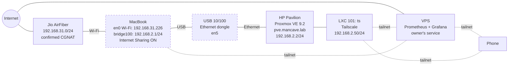
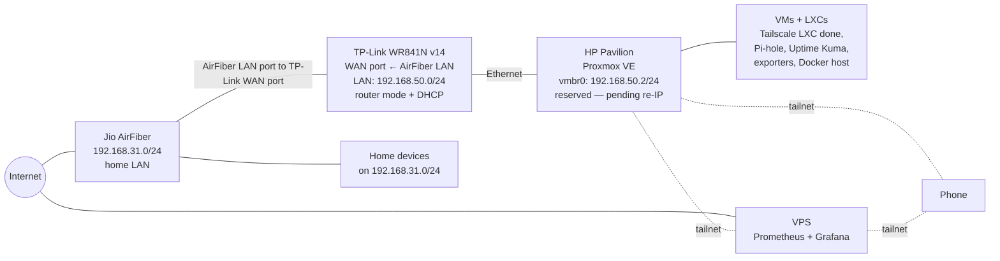
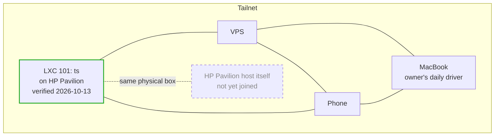

# mancave.lab: Topology

Living diagram of the homelab's physical and logical wiring. Update whenever the layout changes materially, and add a row to the Changelog in `context.md` so the two stay in sync.

**Conventions**

- Each diagram has an "as of" date and a short note on what's temporary.
- Physical links are solid arrows; overlay/logical links (e.g. Tailscale) are dashed.
- Subnets and fixed IPs are called out on the node or the link.

## Current: install-day setup

*As of 2026-10-13. Still the active physical layout — the TP-Link direct-wire replacement is in progress (cable being run) but not yet complete. The HP now also hosts a Tailscale LXC (vmid 101, `192.168.2.50/24`), shown here for completeness; see the Tailnet overlay below for how it fits logically.*

**Notes**

- HP traffic path: HP → Mac `bridge100` → Mac `en0` → AirFiber → internet. Two layers of NAT, no inbound.
- **While this layout is active, the HP (and anything on it, including the Tailscale LXC) has no internet — and therefore no tailnet access — unless the MacBook is actively sharing.** This is the main reason the direct-wire replacement below is in progress.
- The HP host itself is still not tailnet-joined; only the LXC is. See Tailnet overlay.
- Dongle is 10/100, so dist-upgrades and ISO pulls through the Mac are slow by design.

## Planned: double NAT with isolated lab subnet

*Target layout — Ethernet run from the TP-Link to the HP is in progress as of 2026-10-13 (no longer a someday-plan, actively being wired this week). HP, VPS and phone meet on the tailnet; inbound from the internet is not relied on.*

**Notes**

- DHCP runs on the AirFiber for 192.168.31.0/24 and on the TP-Link for 192.168.50.0/24 — never two DHCP servers in the same subnet.
- Home devices on 192.168.31.0/24 cannot reach the lab subnet directly; access from the phone goes over the tailnet.
- Reserve `192.168.50.2` (or similar) on the TP-Link for the Proxmox host so `vmbr0` has a stable address. **The Tailscale LXC (vmid 101) also needs re-IP'ing onto this subnet once wired** — currently on `192.168.2.50/24`, matching the temporary layout above.
- Confirmed: TP-Link must be on its **WAN port** (not a LAN port) for this to actually route/NAT rather than just bridge.
- If the AirFiber blocks custom DNS, set Pi-hole as the DNS server in the TP-Link's DHCP scope instead — still unconfirmed whether the AirFiber exposes this setting at all.
- Put the AirFiber, TP-Link and HP on the same inverter/UPS circuit — otherwise a power cut takes connectivity down with the host.
- Confirmed: double NAT itself isn't a problem for inbound here — CGNAT upstream already blocks that regardless of local NAT layering. Cat 6 confirmed as sufficient cable for both runs (TP-Link's 10/100 ports are the actual ceiling).

## Tailnet overlay (logical)

*Independent of physical wiring. Shown separately because the tailnet cuts across whichever physical layout is current. **Updated 2026-10-13: the "where does Tailscale run" question is resolved — it runs in an LXC, not on the host directly.***

**Resolved:** Tailscale runs in an unprivileged LXC (vmid 101, hostname `ts.mancave.lab`, shows truncated as `ts` on the tailnet — expected Tailscale behavior). Verified via `tailscale status` listing it alongside VPS and phone, and a successful round-trip `tailscale ping` to another peer.

**Still open:** whether this LXC (or a separate one) should later become a **subnet router** advertising `192.168.50.0/24`, once that subnet exists, so other tailnet devices (like the phone) can reach lab services directly by LAN IP rather than needing each service individually joined to the tailnet. Decision pending — not blocking anything today.

**Known gap (not a topology issue, but relevant context):** no root password or SSH is set up on the LXC yet — only reachable via `pct enter` from the Proxmox host console. Tracked in `context.md`.

## Changelog

| Date | Change |
| --- | --- |
| 2026-10-13 | Tailnet overlay updated: Tailscale LXC (vmid 101) added and marked resolved/verified, replacing the old "planned, not yet joined" placeholder for the HP. Install-day diagram updated to show the LXC and flag the MacBook-dependency limitation explicitly. Planned double-NAT diagram annotated: TP-Link WAN port confirmed, re-IP need for both host and LXC noted, double-NAT/CGNAT and Cat 6 clarified as non-issues. New "still open" note added for the subnet-router question (separate from the now-resolved "where does Tailscale run" question). |
| 2026-10-12 | Initial version: install-day setup via MacBook Internet Sharing, planned double-NAT layout, tailnet overlay |
