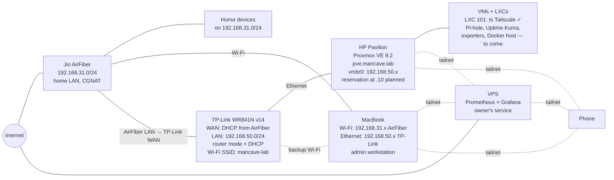
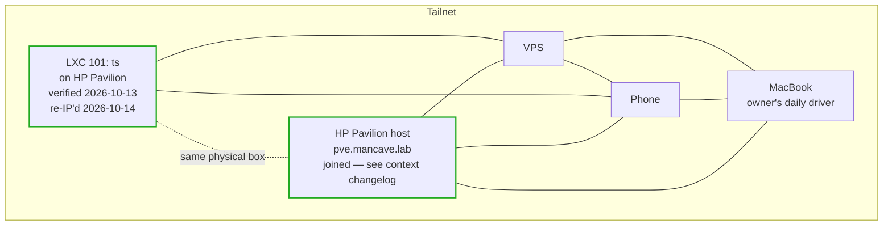

# mancave.lab: Topology

Living diagram of the homelab's physical and logical wiring. Update whenever the layout changes materially, and add a row to the Changelog in `context.md` so the two stay in sync.

**Conventions**

- Each diagram has an "as of" date and a short note on what's temporary.
- Physical links are solid arrows; overlay/logical links (e.g. Tailscale) are dashed.
- Subnets and fixed IPs are called out on the node or the link.

## Current: double NAT with isolated lab subnet

*As of 2026-10-14. HP, VPS and phone meet on the tailnet; inbound from the internet is not relied on (CGNAT upstream). The install-day MacBook Internet Sharing path is retired — see runbooks 01 and 04 for how we got here.*

**Notes**

- DHCP runs on the AirFiber for 192.168.31.0/24 and on the TP-Link for 192.168.50.0/24 — never two DHCP servers in the same subnet.
- Home devices on 192.168.31.0/24 cannot reach the lab subnet directly; access from the phone goes over the tailnet.
- The Mac is dual-homed: AirFiber Wi-Fi for everyday internet (192.168.31.x), USB-Ethernet dongle into the TP-Link when lab admin access is needed (192.168.50.x). Service Order on the Mac keeps Wi-Fi as the default internet route so sites still load while plugged into the TP-Link.
- Reserve 192.168.50.10 on the TP-Link for the HP (MAC `c8:d9:d2:93:53:93`) so `vmbr0` has a stable address — tracked as "planned" in `context.md`. Pick anything outside the DHCP pool (default pool is .100–.199).
- TP-Link must be on its **WAN port** (not a LAN port) for it to actually route/NAT; this bit us during setup.
- If the AirFiber blocks custom DNS, set Pi-hole as the DNS server in the TP-Link's DHCP scope instead — still unconfirmed whether the AirFiber exposes this setting at all.
- TP-Link's own 2.4 GHz Wi-Fi (SSID `mancave-lab`) is enabled as a backup path to reach `192.168.50.x` from the Mac or phone when no cable is at hand. Not fast (10/100 and 2.4 GHz only), but useful when the dongle isn't plugged in.
- Put the AirFiber, TP-Link and HP on the same inverter/UPS circuit — otherwise a power cut takes connectivity down with the host.
- Double NAT itself isn't a problem for inbound: CGNAT upstream already blocks that regardless of local NAT layering. Cat 6 is sufficient for both runs (TP-Link's 10/100 ports are the actual ceiling).

## Tailnet overlay (logical)

*Independent of physical wiring. Shown separately because the tailnet cuts across whichever physical layout is current. Both the HP host and the `ts` LXC are tailnet peers in their own right — two independent paths into the box.*

**Resolved:**

- **Tailscale in an LXC.** Unprivileged `ts` LXC (vmid 101, hostname `ts.mancave.lab`, shows truncated as `ts` on the tailnet — expected Tailscale behavior). Verified via `tailscale status` listing it alongside VPS and phone, and a successful round-trip `tailscale ping` to another peer. Session was re-authed on 2026-10-14 after the subnet cutover temporarily knocked it offline.
- **Tailscale on the HP host itself.** Host is now a first-class tailnet peer in its own right, independent of the `ts` LXC. If the LXC dies, remote access to the host still works — and vice versa. The `same physical box` dashed edge in the diagram is informational: both nodes happen to run on the same hardware but neither depends on the other for tailnet connectivity.

**Still open:**

- **Subnet router.** Now that `192.168.50.0/24` exists, some tailnet node needs to advertise it so other tailnet devices (like the phone) can reach lab services directly by LAN IP rather than needing each service individually joined to the tailnet. Two reasonable candidates:
  - The `ts` LXC advertises the route — keeps the router role out of the host, which stays "just the hypervisor"
  - The HP host advertises the route — simpler, one fewer moving part, uses a node that's already there
  - Not blocking anything today; decide when Pi-hole or Uptime Kuma go in and the "reach lab IPs from the phone" question becomes concrete.
- **IP forwarding sysctl.** Whichever node ends up advertising the subnet route needs `net.ipv4.ip_forward=1` and the IPv6 equivalent set. `tailscale up --advertise-routes` doesn't flip the forwarding switch itself — classic gotcha.

**Known gap (not a topology issue, but relevant context):** no root password or SSH is set up on the `ts` LXC yet — only reachable via `pct enter` from the Proxmox host console. The host being on the tailnet directly means this gap is less urgent (you can reach the host via tailnet SSH, then `pct enter` from there) but still worth closing. Tracked in `context.md`.

## Changelog

| Date | Change |
| --- | --- |
| 2026-10-14 | HP host joined to the tailnet directly — second tailnet node on the box alongside the `ts` LXC. Tailnet overlay updated: HP node promoted from "not yet joined" (dashed/greyed) to a first-class peer with `done` styling; `same physical box` edge kept but reframed as informational rather than a dependency. "Still open: Tailscale on host" removed from the open-items list. Subnet-router question updated to list both candidates (`ts` LXC or HP host) rather than defaulting to the LXC. New gotcha added for `ip_forward` sysctl. |
| 2026-10-14 | TP-Link cutover complete: "Planned" layout promoted to "Current" with as-of 2026-10-14. "Install-day setup via MacBook Internet Sharing" section removed — captured in runbook_01 and runbook_04. HP now on 192.168.50.x via TP-Link DHCP (reservation at .10 planned). `ts` LXC re-IP'd onto 192.168.50.x via DHCP after its hardcoded 192.168.2.50 broke on the subnet change; Tailscale session re-authed after the outage. Mac added to the current diagram as a dual-homed admin workstation (AirFiber Wi-Fi + TP-Link Ethernet). TP-Link backup Wi-Fi path (SSID `mancave-lab`) added. |
| 2026-10-13 | Tailnet overlay updated: Tailscale LXC (vmid 101) added and marked resolved/verified, replacing the old "planned, not yet joined" placeholder for the HP. Install-day diagram updated to show the LXC and flag the MacBook-dependency limitation explicitly. Planned double-NAT diagram annotated: TP-Link WAN port confirmed, re-IP need for both host and LXC noted, double-NAT/CGNAT and Cat 6 clarified as non-issues. New "still open" note added for the subnet-router question (separate from the now-resolved "where does Tailscale run" question). |
| 2026-10-12 | Initial version: install-day setup via MacBook Internet Sharing, planned double-NAT layout, tailnet overlay |
